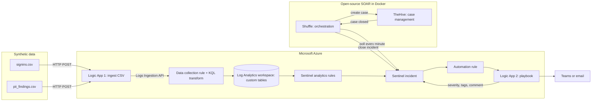

# Sentinel + Logic Apps + Open-Source SOAR: a Learning Lab

> **This is a learning project.** It is built for a YouTube learning series on the *CISSP Coffee Shot* channel.
> Everything here uses **synthetic data in a lab tenant**. It is not production guidance, it is not a hardened
> deployment, and it is not affiliated with Microsoft, StrangeBee (TheHive) or Shuffle.

Follow one security incident from a **CSV file** all the way to a **closed case**, using:

- **Microsoft Sentinel**: the SIEM that detects
- **Azure Logic Apps**: the workflow engine that ingests data and runs playbooks
- **Shuffle**: open-source SOAR that orchestrates
- **TheHive**: case management where the analyst works the case

Two use cases are included:

| # | Use case | What you learn |
|---|---|---|
| 1 | **Brute force, then success** | Custom tables, DCR transforms, KQL joins, entity mapping, playbook enrichment, SOAR fetch → case → close → mirror |
| 2 | **PII exposure across laptops and cloud** | Risk scoring in KQL, **severity ranges** with dynamic severity, routing by severity, case templates and SLAs |

---

## Architecture



More diagrams (sequence of one incident, where each piece runs): [docs/architecture.md](docs/architecture.md)

---

## Video series

| Episode | Title | Guide |
|---|---|---|
| **0** | **Prerequisites: build a free SOC lab** | [docs/00-prerequisites.md](docs/00-prerequisites.md) · [script](docs/videos/ep00-prerequisites-script.md) |
| 1 | Brute force → Sentinel → Logic Apps → Shuffle → TheHive, end to end | [use case 1](docs/use-cases/01-brute-force.md) |
| 2 | PII exposure with severity ranges | [use case 2](docs/use-cases/02-pii-exposure.md) |

Full shot lists: [docs/video-series.md](docs/video-series.md)

---

## Build guide

| Step | Guide |
|---|---|
| 0 | [Prerequisites and free hosting options](docs/00-prerequisites.md) |
| 1 | [Sentinel workspace, custom tables and DCRs](docs/01-sentinel-workspace.md) |
| 2 | [Logic App 1: ingest the CSV](docs/02-ingest-logic-app.md) |
| 3 | [Detections (analytics rules)](docs/03-detections.md) |
| 4 | [Playbooks and automation rules](docs/04-playbooks.md) |
| 5 | [Shuffle + TheHive](docs/05-shuffle-thehive.md) |
| 6 | [Dry run, recording checklist and cleanup](docs/06-dry-run-and-cleanup.md) |

## Repo map

```
data/generators/        Python scripts that create the synthetic CSVs (fresh timestamps every run)
data/schema/            Sample JSON used to create the custom tables in the portal
sentinel/dcr/           KQL transforms for the data collection rules
sentinel/analytics/     KQL for the analytics rules
sentinel/watchlists/    Watchlist used when you have no threat-intel API key
logic-apps/             Logic App workflow definitions (paste into Code view)
soar/                   Shuffle + TheHive install scripts, memory caps, API request templates
scripts/                Prerequisite checker
docs/                   Step-by-step guides, architecture, video scripts
```

## Quick start

```bash
git clone <this repo>
cd sentinel-soar-learning-lab
bash scripts/check-prereqs.sh                          # what is installed, how much RAM you have
python3 data/generators/make_signins.py             # writes signins.csv with fresh timestamps
python3 data/generators/make_pii_findings.py        # writes pii_findings.csv
```

Then follow the build guide from step 1.

## Cost

Designed to run at **$0** for a learning project:

- **Sentinel**: a new workspace gets a 31-day free trial (10 GB/day). The CSVs are a few KB.
- **Logic Apps (Consumption)**: a few cents at this volume; covered by an Azure free account credit if you have one.
- **Shuffle + TheHive**: self-hosted, free. Run them on an Oracle Cloud Always Free ARM VM, or on your own machine.

Set a budget alert anyway, and delete the resource group when you are done (see [cleanup](docs/06-dry-run-and-cleanup.md)).

## Safety rules for this lab

1. Use a **lab tenant** or a dedicated test subscription. Never point this at production.
2. All data is **synthetic**. The PII generator creates fake records only.
3. Any real containment step (revoking sessions, removing sharing links) runs only against **lab test accounts**.
4. Never commit secrets. Client secrets and API keys go in Key Vault or local `.env` files (already git-ignored).

## License

[MIT](LICENSE): use it to learn, teach and build.
