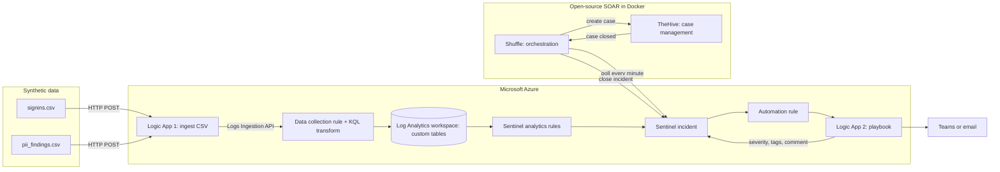

# Sentinel + Logic Apps + Open-Source SOAR: a Learning Lab

> **This is a learning project.** It is built for a YouTube learning series on the *CISSP Coffee Shot* channel.
> Everything here uses **synthetic data in a lab tenant**. It is not production guidance, it is not a hardened
> deployment, and it is not affiliated with Microsoft, StrangeBee (TheHive) or Shuffle.

Follow one security incident from a **CSV file** all the way to a **closed case**, using:

- **Microsoft Sentinel**: the SIEM that detects
- **Azure Logic Apps**: the workflow engine that ingests data and runs playbooks
- **Shuffle**: open-source SOAR that orchestrates
- **TheHive**: case management where the analyst works the case

Two use cases are included:

| # | Use case | What you learn |
|---|---|---|
| 1 | **Brute force, then success** | Custom tables, DCR transforms, KQL joins, entity mapping, playbook enrichment, SOAR fetch → case → close → mirror |
| 2 | **PII exposure across laptops and cloud** | Risk scoring in KQL, **severity ranges** with dynamic severity, routing by severity, case templates and SLAs |

---

## Why a home lab, and why hands-on

Reading about a SOC is not the same as running one. This lab is built so you learn by doing:

- **Watch logs become alerts.** You send the data in, write the rule and see the incident open. You build every handoff a real alert goes through.
- **Learn the most when it breaks.** Every step has a visible result, so when something does not show up, you know which step to check.
- **Know the answer before you start.** The synthetic data has a fixed mix, so the generators tell you what to expect and you can check your own work.
- **Mistakes are safe and cheap.** A lab tenant, synthetic data, free tiers and trial credit. Break it, fix it, run it again.
- **Rebuild it until it sticks.** Every script and query is in this repo, so you can tear the lab down and build it again from memory.
- **It is proof.** Hiring managers ask what you have built. Your lab, your fork of this repo and your notes answer that. The skills map to CISSP Domain 7, Security Operations.

How to use it: watch an episode, then build that part yourself before you move on.

---

## Architecture



More diagrams (sequence of one incident, where each piece runs): [docs/architecture.md](docs/architecture.md)

### From CSV to TheHive: how every piece links

**[docs/csv-to-thehive.md](docs/csv-to-thehive.md)** follows one row of `signins.csv` through all 15 hops, and shows
the URL, name, ID or tag that links each piece to the next:

`signins.csv` → Logic App trigger URL → `ingestionUrl` (DCR + stream `Custom-SignInDemo_CL`) → table `SignInDemo_CL`
→ analytics rule → incident + entities → automation rule → playbook (severity High, `auto-enriched`)
→ Shuffle polls `status eq 'New'` → TheHive case tagged `sentinel-<N>` → analyst closes → Shuffle closes the incident.

It also has a **field mapping** that takes one data element (the attacker IP) through CSV → Logic App → Sentinel →
Shuffle → TheHive, with an XSOAR column for comparison, and ends with a check for each link, so when something
doesn't show up you know which hop broke.

---

## Video series

[](https://youtu.be/JT4phZDic5Q)

- ▶ **Full course, all parts in one video (32 min):** [https://youtu.be/JT4phZDic5Q](https://youtu.be/JT4phZDic5Q). Chapters and scripts: [docs/videos/full-course.md](docs/videos/full-course.md)
- 📺 **Playlist, Microsoft Sentinel for Beginners (Sentinel 101):** [https://www.youtube.com/playlist?list=PLYyAEoIo5XUE](https://www.youtube.com/playlist?list=PLYyAEoIo5XUE). Ten short episodes plus the full course
- ⚙️ **Then go deeper:** [Logic Apps 101](https://www.youtube.com/playlist?list=PLVvlY_JdOdjo) → [Shuffle 101](https://www.youtube.com/playlist?list=PLDadymNcqIQw) → [TheHive 101](https://www.youtube.com/playlist?list=PLKYCG1hT414s), 26 short episodes ([all links below](#part-2-soar-deep-dives-logic-apps-101--shuffle-101--thehive-101))
- 🔔 **Channel:** [CISSP Coffee Shot](https://www.youtube.com/@CISSP-COFFEE-SHOT)

| Episode | Title | Guide |
|---|---|---|
| **0** | **Prerequisites: build a free SOC lab** | [docs/00-prerequisites.md](docs/00-prerequisites.md) · [script](docs/videos/ep00-prerequisites-script.md) |
| 1 | Set up your lab, step by step (macOS) | [script](docs/videos/ep01-setup-your-lab-script.md) |
| 2 | Turn on Microsoft Sentinel | [docs/01-sentinel-workspace.md](docs/01-sentinel-workspace.md) · [script](docs/videos/ep02-sentinel-workspace-script.md) |
| 3 | The custom table and its transform | [script](docs/videos/ep03-custom-table-script.md) |
| 4 | The Logic App that sends the CSV in | [docs/02-ingest-logic-app.md](docs/02-ingest-logic-app.md) · [script](docs/videos/ep04-logic-app-ingest-script.md) |
| 5 | The detection rule: query in, incident out | [docs/03-detections.md](docs/03-detections.md) · [script](docs/videos/ep05-detection-rule-script.md) |
| Bonus | Microsoft Sentinel 101, by example | [playlist](https://www.youtube.com/playlist?list=PLYyAEoIo5XUE) · [docs/video-series.md](docs/video-series.md) |
| 6 | The playbook: the incident starts a response by itself | [docs/04-playbooks.md](docs/04-playbooks.md) · [script](docs/videos/ep06-playbook-script.md) |
| 7a | The SOAR box: one VM with TheHive and Shuffle | [docs/05-shuffle-thehive.md](docs/05-shuffle-thehive.md) · [script](docs/videos/ep07a-soar-box-script.md) |
| 7b | Sentinel to TheHive, and back | [docs/05-shuffle-thehive.md](docs/05-shuffle-thehive.md) · [script](docs/videos/ep07b-sentinel-to-thehive-script.md) |
| 8 | PII exposure, with severity ranges | [use case 2](docs/use-cases/02-pii-exposure.md) · [script](docs/videos/ep08-pii-exposure-script.md) |
| Next | The full dry run, brute force end to end, then cleanup | [use case 1](docs/use-cases/01-brute-force.md) · [docs/06-dry-run-and-cleanup.md](docs/06-dry-run-and-cleanup.md) |

Full shot lists: [docs/video-series.md](docs/video-series.md)

### Part 2: SOAR deep dives (Logic Apps 101 → Shuffle 101 → TheHive 101)

After Sentinel 101, three short beginner series go deeper into each tool in this lab. Every episode is about 1 to 1.5 minutes, uses one everyday analogy, then shows the real thing in this lab with synthetic data. Watch them in order.

- ⚙️ **Logic Apps 101** (9 episodes): [playlist](https://www.youtube.com/playlist?list=PLVvlY_JdOdjo). Triggers, actions, expressions, managed identity, run history and Logic Apps as Sentinel playbooks. Lab files: [`logic-apps/`](logic-apps/), [`playbooks/`](playbooks/), guides [02](docs/02-ingest-logic-app.md) and [04](docs/04-playbooks.md)
- 🔀 **Shuffle 101** (9 episodes): [playlist](https://www.youtube.com/playlist?list=PLDadymNcqIQw). What SOAR is, locking Shuffle down, apps and secrets, and the two workflows: Sentinel to TheHive, and closing the loop. Lab files: [`soar/shuffle/`](soar/shuffle/), guide [05](docs/05-shuffle-thehive.md)
- 🐝 **TheHive 101** (8 episodes): [playlist](https://www.youtube.com/playlist?list=PLKYCG1hT414s). Organisations and roles, alerts vs cases, working and closing a case, dashboards, and TheHive vs the XSOAR War Room. Lab files: [`soar/thehive/`](soar/thehive/), guide [05](docs/05-shuffle-thehive.md)

<details>
<summary><b>Logic Apps 101: all episodes</b></summary>

| Episode | Title | Watch | Publishes |
|---|---|---|---|
| 01 | What Is a Logic App? Azure Workflows Explained | [youtu.be/dQnlrZtfzyk](https://youtu.be/dQnlrZtfzyk) | Nov 23 |
| 02 | Consumption vs Standard: Logic Apps Pricing Explained | [youtu.be/p0GgjMBDTDg](https://youtu.be/p0GgjMBDTDg) | Nov 23 |
| 03 | Logic App Triggers: HTTP Request, Schedule & Events | [youtu.be/4r1blb4qmwE](https://youtu.be/4r1blb4qmwE) | Nov 23 |
| 04 | Logic App Actions in the Designer: Compose, Filter, Select, HTTP | [youtu.be/KMZSv3dlmFU](https://youtu.be/KMZSv3dlmFU) | Nov 24 |
| 05 | Logic App Expressions, Dynamic Content & Code View | [youtu.be/sCDQZ-auQZE](https://youtu.be/sCDQZ-auQZE) | Nov 24 |
| 06 | Logic App Managed Identity: Connections Without Passwords | [youtu.be/nKuM5ibAIxA](https://youtu.be/nKuM5ibAIxA) | Nov 24 |
| 07 | Logic App Run History: Debug & Resubmit a Run | [youtu.be/A1IUFiYpXes](https://youtu.be/A1IUFiYpXes) | Nov 25 |
| 08 | Logic Apps as Microsoft Sentinel Playbooks (SOAR) | [youtu.be/6OSUxf4hVsM](https://youtu.be/6OSUxf4hVsM) | Nov 25 |
| 09 | Logic Apps Monitoring, Cost & Lab Clean-Up | [youtu.be/MfAIVEKmO0w](https://youtu.be/MfAIVEKmO0w) | Nov 25 |

</details>

<details>
<summary><b>Shuffle 101: all episodes</b></summary>

| Episode | Title | Watch | Publishes |
|---|---|---|---|
| 01 | What Is SOAR? Shuffle Open-Source SOAR Explained | [youtu.be/1i_kBLCBN74](https://youtu.be/1i_kBLCBN74) | Nov 26 |
| 02 | Where Shuffle Runs: Docker, Ports & Locking It Down | [youtu.be/oA4Yeb_RwYk](https://youtu.be/oA4Yeb_RwYk) | Nov 26 |
| 03 | A Tour of Shuffle: Workflows, Apps & Runs | [youtu.be/VYMlvE5P8Hg](https://youtu.be/VYMlvE5P8Hg) | Nov 26 |
| 04 | Shuffle Apps & Authentication: Keep Secrets Out of Workflows | [youtu.be/9jWX_MorsbU](https://youtu.be/9jWX_MorsbU) | Nov 27 |
| 05 | Shuffle Workflow Building Blocks: Triggers, Actions, Conditions | [youtu.be/NFdrzq62U2I](https://youtu.be/NFdrzq62U2I) | Nov 27 |
| 06 | Shuffle Workflow: Microsoft Sentinel to TheHive | [youtu.be/ZhFhudBeHYw](https://youtu.be/ZhFhudBeHYw) | Nov 27 |
| 07 | Debugging Shuffle Workflows: Reading Runs | [youtu.be/au3TkR_2rME](https://youtu.be/au3TkR_2rME) | Nov 28 |
| 08 | Shuffle Workflow: Close the Loop Back to Microsoft Sentinel | [youtu.be/-Glcdm8jkMI](https://youtu.be/-Glcdm8jkMI) | Nov 28 |
| 09 | Shuffle vs Cortex XSOAR: What Maps to What | [youtu.be/9c0ObkdcCuU](https://youtu.be/9c0ObkdcCuU) | Nov 28 |

</details>

<details>
<summary><b>TheHive 101: all episodes</b></summary>

| Episode | Title | Watch | Publishes |
|---|---|---|---|
| 01 | What Is TheHive? Case Management for SOC Analysts | [youtu.be/aeD8neImKjI](https://youtu.be/aeD8neImKjI) | Nov 29 |
| 02 | TheHive Organisations, Users & Roles | [youtu.be/M0yQtQj4jRc](https://youtu.be/M0yQtQj4jRc) | Nov 29 |
| 03 | TheHive Alerts vs Cases: What's the Difference? | [youtu.be/y5EJ-JRB7Hc](https://youtu.be/y5EJ-JRB7Hc) | Nov 29 |
| 04 | Anatomy of a TheHive Case: Observables, Tasks, TTPs & Timeline | [youtu.be/bgHh1iAGdqw](https://youtu.be/bgHh1iAGdqw) | Nov 30 |
| 05 | Working a TheHive Case as a SOC Analyst | [youtu.be/rxlVnjg9c5U](https://youtu.be/rxlVnjg9c5U) | Nov 30 |
| 06 | Closing a TheHive Case with a Verdict (True Positive) | [youtu.be/B4AqULFARwc](https://youtu.be/B4AqULFARwc) | Nov 30 |
| 07 | TheHive Timelines & Dashboards | [youtu.be/ocHoAvH_dcw](https://youtu.be/ocHoAvH_dcw) | Dec 1 |
| 08 | TheHive vs Cortex XSOAR War Room | [youtu.be/tmMaiMG_7tM](https://youtu.be/tmMaiMG_7tM) | Dec 1 |

</details>

Episodes publish three a day from Nov 23 to Dec 1, 2026; a link shows "video unavailable" until its date.

---

## Build guide

| Step | Guide |
|---|---|
| 0 | [Prerequisites and free hosting options](docs/00-prerequisites.md) |
| 1 | [Sentinel workspace, custom tables and DCRs](docs/01-sentinel-workspace.md) |
| 2 | [Logic App 1: ingest the CSV](docs/02-ingest-logic-app.md) |
| 3 | [Detections (analytics rules)](docs/03-detections.md) |
| 4 | [Playbooks and automation rules](docs/04-playbooks.md) |
| 5 | [Shuffle + TheHive](docs/05-shuffle-thehive.md) |
| 6 | [Dry run, recording checklist and cleanup](docs/06-dry-run-and-cleanup.md) |
| Map | [From CSV to TheHive: how every piece links](docs/csv-to-thehive.md) |

## Repo map

```
data/generators/        Python scripts that create the synthetic CSVs (fresh timestamps every run)
data/schema/            Sample JSON used to create the custom tables in the portal
sentinel/dcr/           KQL transforms for the data collection rules
sentinel/analytics/     KQL for the analytics rules
sentinel/watchlists/    Watchlist used when you have no threat-intel API key
logic-apps/             Logic App workflow definitions (paste into Code view)
soar/                   Shuffle + TheHive install scripts, memory caps, API request templates
scripts/                Prerequisite checker
docs/                   Step-by-step guides, architecture, CSV-to-TheHive map, video scripts
```

## Quick start

```bash
git clone <this repo>
cd sentinel-soar-learning-lab
bash scripts/check-prereqs.sh                          # what is installed, how much RAM you have
python3 data/generators/make_signins.py             # writes signins.csv with fresh timestamps
python3 data/generators/make_pii_findings.py        # writes pii_findings.csv
```

Then follow the build guide from step 1.

## Cost

Designed to run at **$0** for a learning project:

- **Sentinel**: a new workspace gets a 31-day free trial (10 GB/day). The CSVs are a few KB.
- **Logic Apps (Consumption)**: a few cents at this volume; covered by an Azure free account credit if you have one.
- **Shuffle + TheHive**: self-hosted, free. TheHive's Community license from StrangeBee is free for non-commercial use (students, researchers and home labs; 2 users, 1 organization), a good fit for this lab. Run them on a small Azure VM that you stop between sessions (the series does this in Episode 7a), an Oracle Cloud Always Free ARM VM, or your own machine.

Set a budget alert anyway, and delete the resource group when you are done (see [cleanup](docs/06-dry-run-and-cleanup.md)).

## Safety rules for this lab

1. Use a **lab tenant** or a dedicated test subscription. Never point this at production.
2. All data is **synthetic**. The PII generator creates fake records only.
3. Any real containment step (revoking sessions, removing sharing links) runs only against **lab test accounts**.
4. Never commit secrets. Client secrets and API keys go in Key Vault or local `.env` files (already git-ignored).

## License

[MIT](LICENSE): use it to learn, teach and build.
