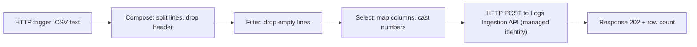

# Step 2 — Logic App 1: ingest the CSV

> Learning lab. Lab subscription only.

**Why an HTTP action and not a built-in connector?** The old "Azure Log Analytics Data Collector" connector uses
the retired HTTP Data Collector API. The supported route is the **Logs Ingestion API**, called with HTTP and a
managed identity.

## 2.1 Create the Logic Apps (Consumption)

Create two Logic Apps in `rg-soc-lab`: `la-ingest-signins` and `la-ingest-pii`.

For each one:

1. **Identity → System assigned → On**.
2. **Logic app code view** → paste `logic-apps/ingest-signins/workflow.json` (or `ingest-pii/workflow.json`) → Save.
3. **Parameters** → set `ingestionUrl` to the URL from step 1.3 → Save.

What the workflow does:



## 2.2 Give the Logic App permission on the DCR

```bash
PRINCIPAL=$(az logic workflow show -g rg-soc-lab -n la-ingest-signins --query identity.principalId -o tsv)
DCR_ID=$(az monitor data-collection rule show -g rg-soc-lab -n dcr-signin-demo --query id -o tsv)
az role assignment create --assignee-object-id "$PRINCIPAL" --assignee-principal-type ServicePrincipal \
  --role "Monitoring Metrics Publisher" --scope "$DCR_ID"
```

Repeat for `la-ingest-pii` and `dcr-pii-findings`. Role assignments can take a few minutes to apply.

## 2.3 Send a CSV

Copy the trigger URL from the Logic App (**Overview → Workflow URL**, or open the trigger in the designer).
Treat it like a password: it contains a signature.

```bash
python3 data/generators/make_signins.py --domain yourlab.onmicrosoft.com --victim lab.victim
curl -sS -X POST -H "Content-Type: text/plain" --data-binary @signins.csv "$SIGNINS_TRIGGER_URL"
# -> {"rowsSent":58,"table":"SignInDemo_CL"}
```

Then in Logs: `SignInDemo_CL | take 10`. The first rows in a brand-new table can take several minutes to appear.

## Alternative: Blob Storage trigger (designer)

If you prefer "drop a file in storage" for the video, build it in the designer: trigger **Azure Blob Storage →
When a blob is added or modified (properties only) (V2)** → **Get blob content (V2)** → then the same Compose,
Filter, Select and HTTP steps, using `body('Get_blob_content_(V2)')` instead of `triggerBody()`.

## Troubleshooting

| Symptom | Likely cause |
|---|---|
| HTTP step returns 403 | Role assignment missing or not applied yet; wrong audience (must be `https://monitor.azure.com`) |
| HTTP step returns 400 | Column names or types don't match the table; check the DCR's stream declaration |
| Columns shifted | A field contained a comma (this parser is deliberately simple) |
| Run succeeded but no rows | Wait a few minutes; check the DCR's transform didn't filter everything |
