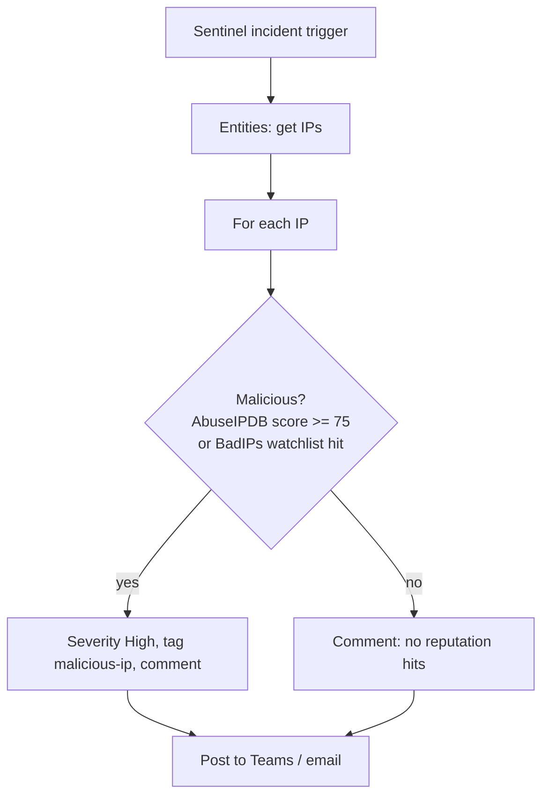

# Step 4: Playbooks and automation rules

> Learning lab. Any containment step runs against lab test accounts only.

Build these in the Logic Apps designer: they use the Microsoft Sentinel connector, which is easiest to wire up in the UI.
Start from **Sentinel → Automation → Create → Playbook with incident trigger**. Give each playbook a system-assigned
identity with **Microsoft Sentinel Responder** on `rg-soc-lab`, and allow Sentinel to run playbooks in the resource
group (**Settings → Playbook permissions**).

## Playbook A: `la-pb-ip-enrich` (use case 1)

- **AbuseIPDB:** HTTP GET `https://api.abuseipdb.com/api/v2/check?ipAddress=<ip>&maxAgeInDays=90`, headers `Key`
  (mark as secure input) and `Accept: application/json`; Parse JSON → `data.abuseConfidenceScore`.
- **No API key:** upload `sentinel/watchlists/BadIPs.csv` as watchlist `BadIPs` (search key `IP`), then
  "Run query and list results": `_GetWatchlist('BadIPs') | where SearchKey == '<ip>'`.

## Playbook B: `la-pb-pii-route` (use case 2)

A **Switch** on the incident severity:

| Severity | Actions |
|---|---|
| High | Tag `pii-high`; post to a #privacy channel; email the owner. Optional lab-only containment: disable public access on the blob container, or remove the OneDrive sharing link through Microsoft Graph |
| Medium | Tag `pii-medium`; email the owner: move, encrypt or delete within 48 hours |
| Low / Informational | Tag `pii-review`; comment only |

## Automation rules

| Rule | Trigger | Condition | Actions | Order |
|---|---|---|---|---|
| Enrich brute-force incidents | When incident is **created** | Analytics rule name contains "Brute force" | Run `la-pb-ip-enrich`; add tag `auto-enriched` | 1 |
| Route PII incidents | When incident is **created** | Analytics rule name contains "PII exposure" | Run `la-pb-pii-route`; add tag `auto-enriched` | 2 |

Trigger on **created** only. Shuffle updates incidents later, and an "updated" trigger would loop.
