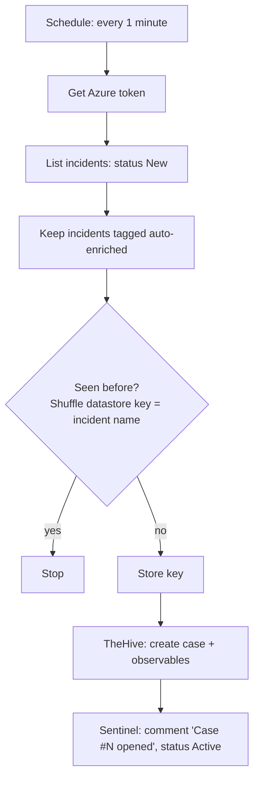

# Step 5: Shuffle + TheHive

> Learning lab. Lock both web UIs to your own IP. Never expose them to the internet with default credentials.

## 5.1 Install

On the Docker host you chose in [step 0](00-prerequisites.md):

```bash
# Ubuntu VM only (skip on a Mac with Colima / Docker Desktop)
bash soar/install-docker-ubuntu.sh

# Shuffle (clones the upstream repo into soar/vendor/ and applies lab memory caps)
bash soar/install-shuffle.sh

# TheHive (minimal lab profile: TheHive + Cassandra + Elasticsearch, memory-capped)
bash soar/install-thehive.sh
```

| Tool | URL | First login |
|---|---|---|
| Shuffle | `https://<host>:3443` (or `http://<host>:3001`) | Create the admin account on first visit |
| TheHive | `http://<host>:9000` | `admin@thehive.local` / `secret`: **change it immediately** |

TheHive 5.3+ needs a **free Community license** from the StrangeBee License Portal, or the UI is read-only.
Create an organisation `SOC-Lab`, an analyst user, and an **API key** for Shuffle.

## 5.2 Give Shuffle access to Sentinel

```bash
APP_ID=$(az ad app create --display-name shuffle-sentinel-lab --query appId -o tsv)
az ad sp create --id "$APP_ID"
az ad app credential reset --id "$APP_ID" --display-name shuffle-lab --years 1   # copy the password once; never commit it
WS_ID=$(az monitor log-analytics workspace show -g rg-soc-lab -n law-soc-lab --query id -o tsv)
az role assignment create --assignee "$APP_ID" --role "Microsoft Sentinel Responder" --scope "$WS_ID"
```

Store the tenant ID, client ID and secret in Shuffle's **App authentication**, not in workflow fields.

## 5.3 Workflow 1: "Sentinel → TheHive" (fetch)

Request templates for every call: [`soar/api/sentinel.http`](../soar/api/sentinel.http) and
[`soar/api/thehive.http`](../soar/api/thehive.http).



### Field mapping

| Sentinel | TheHive |
|---|---|
| `properties.title` | `title` |
| Informational / Low | `severity` 1 (Low) |
| Medium | `severity` 2 (Medium) |
| High | `severity` 3 (High) |
| High from the PII override (`ForceHigh`) | `severity` 4 (Critical) |
| `properties.incidentNumber` | tag `sentinel-<number>` and `sourceRef` |
| Account entity | observable `mail` |
| IP entity | observable `ip` |
| Host entity (PII) | observable `hostname` |
| File entity (PII) | observable `filename` |
| Custom details (`RiskScore`, `PIITypes`, …) | case description / custom fields |
| `properties.incidentUrl` | link in the description |

Updating a Sentinel incident is a `PUT` that needs the current `etag` plus `title`, `severity` and `status`,
so always `GET` the incident right before you write to it.

## 5.4 Workflow 2: "TheHive closed → close Sentinel" (mirror)

1. **Trigger:** Shuffle webhook, called by a TheHive notification when a case closes. If notifications aren't
   available on your licence, poll TheHive every minute for cases closed since the last run instead.
2. Read the `sentinel-<number>` tag to find the incident, `GET` it for the etag.
3. `PUT` the incident: status `Closed`, classification `TruePositive` (or `BenignPositive`), reason, and a
   comment with the TheHive case number.

## 5.5 PII case template (use case 2)

Create a TheHive case template **"PII Exposure"** with tasks:

1. **Validate**: real PII, test data or a false match?
2. **Contain**: remove the public or shared link, move the file, or encrypt it.
3. **Notify the data owner** and record the response.
4. **Privacy officer review** (High and Critical): decide whether breach reporting applies, for example under
   PIPEDA's "real risk of significant harm" test. A human decision, not an automated one.
5. **Close** with a resolution; Shuffle mirrors it to Sentinel.

Set the due date from the severity: High 4 h, Medium 48 h, Low 5 days, Informational 14 days.
