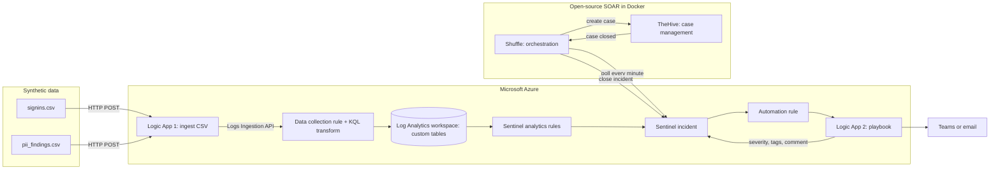
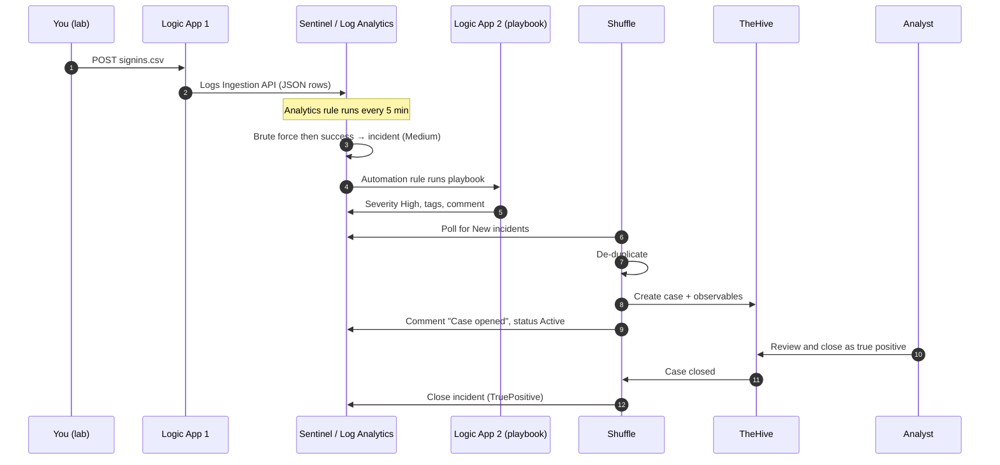
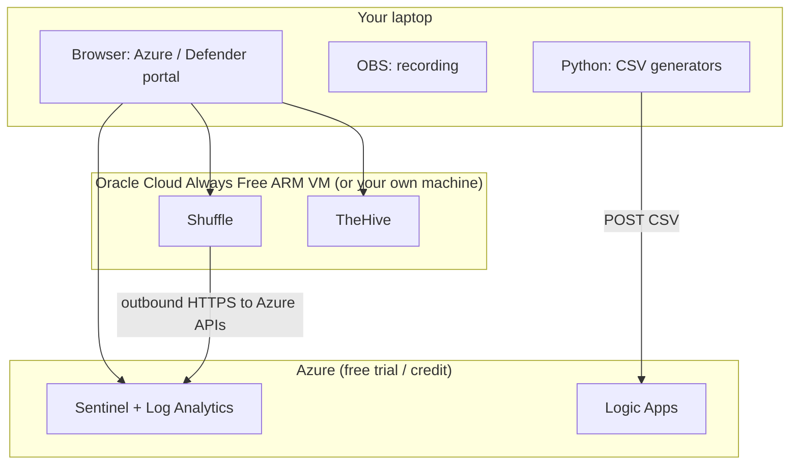

# Architecture

> Learning lab. Synthetic data, lab tenant only.

## 1. Data and control flow

## 2. One incident, step by step (use case 1)

## 3. Where each piece runs (free option)

Shuffle only makes **outbound** calls to Azure (it polls), so it works from a home network or a cloud VM
without opening inbound ports to the internet. Lock the Shuffle and TheHive web UIs to your own IP.

## Who owns what

| Component | Role | Owns |
|---|---|---|
| Logic App 1 | Data connector | Getting the CSV into a table |
| DCR | Data collection rule | Schema and ingestion-time transform |
| Analytics rules | Detection | Deciding what is an incident, and its severity |
| Logic App 2 | Playbook | Fast Azure-side enrichment and notification |
| Shuffle | Orchestration | Moving the incident between tools, de-duplication, closing |
| TheHive | Case management | The analyst's tasks, evidence and decision |

Rule of thumb: **give every field one owner.** Sentinel owns detection fields, TheHive owns the case
decision, and Shuffle is the only thing that writes between them.
