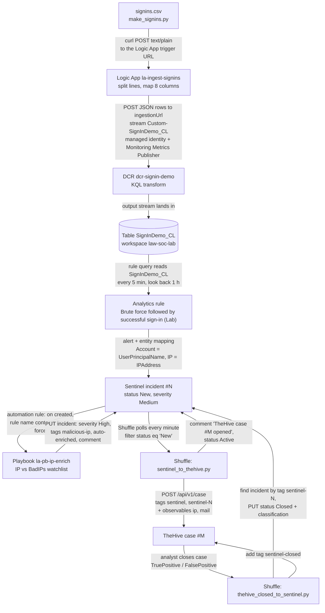

# From a CSV row to a TheHive case, and back

> Learning lab. Synthetic data, lab tenant only.
> Watch it built step by step in the [video series](../README.md#video-series).

This page follows **one row** of `signins.csv` through every hop until it is a TheHive case, and then follows the
analyst's decision back to Sentinel. For each hop it shows **what links it to the next one**: the URL, name, ID or
tag that the next piece looks for. When something does not show up, the broken link is almost always one of these.

## The whole chain on one picture

## Hop by hop

| # | From → to | What links them | Where you set it | Episode |
|---|---|---|---|---|
| 1 | Generator → `signins.csv` | The **8-column header**: `TimeGenerated, UserPrincipalName, IPAddress, Location, ResultType, ResultDescription, AppDisplayName, UserAgent`. Timestamps are "now minus a few minutes" so the rule's 1-hour lookback sees them. | [`data/generators/make_signins.py`](../data/generators/make_signins.py) | 1 |
| 2 | CSV → Logic App 1 | The Logic App's **HTTP trigger URL** (`$SIGNINS_TRIGGER_URL`). You send the file as plain text: `curl -X POST -H "Content-Type: text/plain" --data-binary @signins.csv "$SIGNINS_TRIGGER_URL"` | Logic App → trigger → copy URL | 4 |
| 3 | Inside Logic App 1 | **Column positions**. `Select` maps `split(line, ',')[0..7]` to the column names, so the CSV column order must match the header above. `ResultType` is cast to a number here. | [`logic-apps/ingest-signins/workflow.json`](../logic-apps/ingest-signins/workflow.json) | 4 |
| 4 | Logic App 1 → DCR | The **`ingestionUrl`**: `{endpoint}/dataCollectionRules/{dcr-immutable-id}/streams/Custom-SignInDemo_CL?api-version=2023-01-01`. The Logic App signs in with its **managed identity** (audience `https://monitor.azure.com`), which needs **Monitoring Metrics Publisher** on `dcr-signin-demo`. | [Step 1.3](01-sentinel-workspace.md) and [step 2.2](02-ingest-logic-app.md) | 3, 4 |
| 5 | DCR → table | The DCR's **input stream** `Custom-SignInDemo_CL` and its **output table** `SignInDemo_CL`. The transform drops rows with no user or IP, casts the types and lower-cases the UPN. | [`sentinel/dcr/signins-transform.kql`](../sentinel/dcr/signins-transform.kql) | 3 |
| 6 | Table → analytics rule | The **table name** in the query. The rule counts `ResultType == 50126` failures per user and IP, then joins a later `ResultType == 0` success. 20 or more failures followed by a success = one alert. | [`sentinel/analytics/brute-force-then-success.kql`](../sentinel/analytics/brute-force-then-success.kql) | 5 |
| 7 | Rule → incident | **Entity mapping**: `Account.FullName = UserPrincipalName`, `IP.Address = IPAddress`, custom detail `FailedCount`. The entities are what the playbook and Shuffle read later. Alerts are grouped on Account and IP, so one attack = one incident. | Rule wizard, **Set rule logic** tab | 5 |
| 8 | Incident → playbook | The **automation rule**: trigger *When incident is created*, condition *analytics rule name contains "Brute force"*, action *Run `la-pb-ip-enrich`*. Created only, never updated, so Shuffle's later writes do not loop. | [Step 4](04-playbooks.md) | 6 |
| 9 | Playbook → incident | The playbook reads the incident's **IP entities**, checks them against the **`BadIPs` watchlist**, then `PUT`s the incident with its current **etag**: severity High, tags `malicious-ip` and `auto-enriched`, plus a comment saying why. | [`playbooks/la-pb-ip-enrich/workflow.json`](../playbooks/la-pb-ip-enrich/workflow.json) | 6 |
| 10 | Incident → Shuffle | Shuffle **polls**; nothing pushes to it. Every minute it gets a token for the `shuffle-sentinel-lab` app (role **Microsoft Sentinel Responder** on `law-soc-lab`) and lists incidents with `properties/status eq 'New'`. | [`soar/shuffle/sentinel_to_thehive.py`](../soar/shuffle/sentinel_to_thehive.py), [step 5.2](05-shuffle-thehive.md) | 7b |
| 11 | Shuffle → TheHive | `POST /api/v1/case` with the TheHive **API key**. The link back is the tag **`sentinel-<incidentNumber>`**, plus the incident URL in the description. Severity maps Low/Medium/High to 1/2/3. Entities become observables: IP → `ip`, Account → `mail`, Host → `hostname`. | Same script, [field mapping](05-shuffle-thehive.md#field-mapping) | 7b |
| 12 | Shuffle → incident | Shuffle comments **"TheHive case #M opened"** and sets the incident to **Active**. Active is what stops the next poll from opening a second case. | Same script | 7b |
| 13 | TheHive → Shuffle | The analyst closes the case as **TruePositive** or **FalsePositive** with a summary. The mirror workflow lists cases that are closed, tagged `sentinel` and not yet tagged `sentinel-closed`. | [`soar/shuffle/thehive_closed_to_sentinel.py`](../soar/shuffle/thehive_closed_to_sentinel.py) | 7b |
| 14 | Shuffle → incident | It reads the number from the **`sentinel-<N>`** tag, finds that incident, `GET`s it for a fresh etag, and `PUT`s status **Closed** with the matching classification and a comment quoting the TheHive case. | Same script | 7b |
| 15 | Shuffle → TheHive | It adds the tag **`sentinel-closed`** so the case is never mirrored twice. | Same script | 7b |

## Field mapping: one data element through every tool

### Follow one value: the attacker IP `185.220.101.45`

| Stage | Where it lives | What it looks like there |
|---|---|---|
| 1. CSV | Column 3, `IPAddress` | `2026-11-21T22:10:03Z,lab.victim@yourlab.onmicrosoft.com,185.220.101.45,DE,50126,…` |
| 2. Logic App 1 | `Select` → `"IPAddress": "@split(item(), ',')[2]"` | `{"IPAddress": "185.220.101.45", "ResultType": 50126, …}` (JSON row) |
| 3. Logs Ingestion API | Body of the `POST` to stream `Custom-SignInDemo_CL` | `[{"TimeGenerated": "…", "IPAddress": "185.220.101.45", …}]` |
| 4. DCR transform | `source \| where isnotempty(IPAddress)` | Kept (not empty); no change to the value |
| 5. Sentinel table | `SignInDemo_CL.IPAddress` (string) | `SignInDemo_CL \| where IPAddress == "185.220.101.45"` → 37 failures + 1 success |
| 6. Analytics rule | `summarize … by UserPrincipalName, IPAddress` → `project … IPAddress` | One result row: `IPAddress = 185.220.101.45`, `FailedCount = 37` |
| 7. Entity mapping | `IP` entity, identifier `Address` = `IPAddress` | Incident entity `{"kind": "Ip", "properties": {"address": "185.220.101.45"}}` |
| 8. Alert title | `{{IPAddress}}` placeholder | "Brute force then success for lab.victim@… from 185.220.101.45" |
| 9. Playbook (Logic App 2) | IP entities vs watchlist `BadIPs` (column `IP`) | Match → severity Medium → **High**, tag `malicious-ip`, comment naming the IP |
| 10. Shuffle | `entities[].properties.address` where `kind == "Ip"` | `{"dataType": "ip", "data": "185.220.101.45"}` |
| 11. TheHive | Case observable | Observable type **ip**, value `185.220.101.45`, on case #M |
| XSOAR (instead of Shuffle + TheHive) | Incoming mapper → incident field such as **Source IP**, plus an **IP** indicator | Indicator `185.220.101.45` with reputation from your threat-intel integrations |

### Every element, side by side

| Data element | CSV column | Logic App 1 (`Select`) | Sentinel (`SignInDemo_CL` → rule → incident) | Shuffle (orchestration) | TheHive (case management) | XSOAR equivalent* |
|---|---|---|---|---|---|---|
| Event time | `TimeGenerated` (col 1, ISO text) | `TimeGenerated` (string) | DCR: `todatetime()` → `TimeGenerated` (datetime); rule: `FirstFail`, `LastFail` | Not sent; uses `createdTimeUtc` to order | Case created time | Occurred / created time |
| User | `UserPrincipalName` (col 2) | `UserPrincipalName` | DCR: `tolower()`; entity **Account** `FullName` → `accountName` + `upnSuffix` | Account entity → `accountName@upnSuffix` | Observable **mail** `lab.victim@yourlab.onmicrosoft.com` | **Username** field, **Account** indicator |
| Attacker IP | `IPAddress` (col 3) | `IPAddress` | `IPAddress`; entity **IP** `Address` | IP entity → `address` | Observable **ip** `185.220.101.45` | **Source IP** field, **IP** indicator |
| Country | `Location` (col 4) | `Location` | `Location` (projected by the rule) | Not mapped | Not mapped | Country / geo enrichment |
| Result code | `ResultType` (col 5) | `ResultType` (`int()` cast) | DCR: `toint()`; rule: `50126` = failure, `0` = success | Not mapped (used by the rule only) | Not mapped | Not mapped |
| Failure count | Derived (37 rows of `50126`) | — | Rule: `count()` → custom detail **`FailedCount`** | Not sent by the lab script (read it from the alert's custom details to add it) | Optional: description or a custom field | Custom incident field (via mapper) |
| Severity | — | — | Rule: **Medium**; playbook raises to **High** on a watchlist hit | `Low`/`Medium`/`High` → `1`/`2`/`3` | `severity` 1–3 (4 = Critical for PII override) | **Severity** (1–4) |
| Title | — | — | Alert title template → incident `title` | `properties.title` | Case `title` | Incident **name** |
| Link back | — | — | `incidentNumber`, `name` (GUID), `incidentUrl` | Tag `sentinel-<incidentNumber>` | Tags `sentinel`, `sentinel-<N>`; URL in description | **dbotMirrorId** (mirroring) |
| Status | — | — | `New` → `Active` (Shuffle) → `Closed` | Sets Active after the case opens; Closed on mirror | `Open` → closed as `TruePositive` / `FalsePositive` | Status + close reason, mirrored out |
| Classification | — | — | `classification`, `classificationReason`, `classificationComment` | TheHive status → Sentinel classification | Close status + summary | Close reason + close notes |

\* **XSOAR is not built in this lab.** Palo Alto ended the free XSOAR Community Edition, so the lab uses Shuffle
for orchestration and TheHive for cases. The column shows where the same value would go if you use XSOAR's
Microsoft Sentinel integration instead: its incoming mapper turns incident properties and entities into XSOAR
incident fields and indicators. Exact field names depend on your mapper and incident type.

## The keys that tie it together

| Key | Created by | Read by |
|---|---|---|
| Logic App trigger URL | Logic App 1 | `curl` (you) |
| `ingestionUrl` (endpoint + DCR immutable ID + stream) | DCR | Logic App 1 |
| Stream `Custom-SignInDemo_CL` | DCR | Logic App 1 |
| Table `SignInDemo_CL` | DCR / custom-table wizard | Analytics rule |
| Analytics rule name ("Brute force…") | You | Automation rule condition |
| Entities (Account, IP) | Entity mapping | Playbook, Shuffle |
| Incident `name` (GUID) and `etag` | Sentinel | Playbook, Shuffle (every `PUT`) |
| Incident status `New` → `Active` | Sentinel → Shuffle | Shuffle (de-duplication) |
| Tag `sentinel-<incidentNumber>` | Shuffle | Shuffle mirror workflow |
| Tag `sentinel-closed` | Shuffle | Shuffle mirror workflow (de-duplication) |

## Check each link

Work down the list and stop at the first one that fails. That is the broken link.

| Check | Where | Healthy result |
|---|---|---|
| The `curl` returns | Terminal | `202` with `rowsSent` and `"table": "SignInDemo_CL"` |
| Logic App 1 run | Logic App → Run history | Every action green; `Send_to_Logs_Ingestion_API` returns 204 |
| Rows landed | Logs: `SignInDemo_CL \| take 10` | Rows with lower-case UPNs (allow up to 5–10 min on the first ingest) |
| Rule would fire | Paste the rule query in Logs | At least one row with `FailedCount >= 20` |
| Incident opened | Sentinel → Incidents | "Brute force followed by successful sign-in (Lab)", Medium, entities filled |
| Playbook ran | Incident → Activity log | Severity High, tags `malicious-ip` and `auto-enriched`, playbook comment |
| Shuffle picked it up | Shuffle → workflow runs | `"processed": 1` with the incident and case numbers |
| Case exists | TheHive → Cases | Tags `sentinel`, `sentinel-<N>`; IP and mail observables |
| Incident is Active | Sentinel incident | Comment "TheHive case #M opened…" |
| Close mirrored | After closing the case | Incident Closed with the classification; case tagged `sentinel-closed` |

Common breaks: a 403 at hop 4 (the role assignment hasn't applied yet; wait a few minutes), no rows at hop 5
(wrong stream name or DCR immutable ID in `ingestionUrl`), no incident at hop 7 (old timestamps; re-run the
generator), and a 412 on any `PUT` (stale etag; `GET` the incident again right before writing).

Use case 2 (PII exposure) follows the same chain with `pii_findings.csv`, `la-ingest-pii`, `dcr-pii-findings`,
`PIIFindings_CL`, the PII rules and `la-pb-pii-route`; Shuffle opens those cases from the **PII Exposure** case
template. See [use case 2](use-cases/02-pii-exposure.md).
